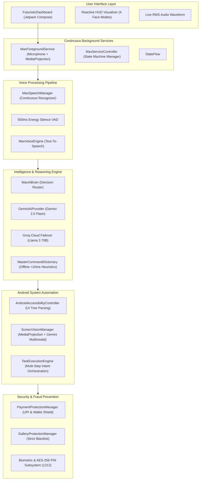

# MAX – Autonomous Multimodal AI Voice & OS Automation Assistant

<p align="center">
  
  
  
  
  
  
</p>

<p align="center">
  <a href="https://github.com/tripmozy-hub/MAX-AI-Assistant/releases/latest/download/MAX.apk">
    
  </a>
</p>

> 📲 **Direct Download Links (Works on Any Phone):**  
> • **Primary (GitHub Release):** **[https://github.com/tripmozy-hub/MAX-AI-Assistant/releases/latest/download/MAX.apk](https://github.com/tripmozy-hub/MAX-AI-Assistant/releases/latest/download/MAX.apk)**  
> • **Fast CDN Mirror:** **[https://files.catbox.moe/dyr6ad.apk](https://files.catbox.moe/dyr6ad.apk)**  
> *(18.7 MB • Android 8.0+ / Android 15 Ready • Direct 1-Click Install • Zero Sign-In Required)*

---

## ⚡ Overview

**MAX** is a next-generation personal AI voice and operating system automation companion for Android. Engineered to operate with deep system-level integration, real-time multimodal vision, and conversational intelligence, MAX breaks away from conventional voice assistants by performing **direct, hands-free automation across installed Android applications without requiring root access**.

---

## 🚀 Key Features & Innovations

### 1. 👁️ Multimodal On-Screen Vision (*"MAX, what is on my screen?"*)
- **Real-Time Context Understanding:** Captures display frames via Android `MediaProjection` and parses the UI accessibility node tree simultaneously.
- **Visual Reasoning:** Transmits visual frames and extracted UI text to Google Gemini Vision to troubleshoot system error dialogs, summarize reading material, and suggest actionable user steps.
- **On-Device Fallback:** Local screen explainer reads out headers, error warnings, and interactive buttons even when offline.

### 2. 🎙️ High-Speed Voice Pipeline & Wake-Word Detection
- **Continuous Standby:** Passive, battery-optimized listening for wake phrases in multiple languages (*"Hey MAX"*, *"Hello MAX"*, *"सुनो मैक्स"*, *"হেই ম্যাক্স"*).
- **550ms Silence VAD (Voice Activity Detection):** Custom endpointing algorithms detect speech cessation and trigger immediate processing within 600ms—eliminating awkward pauses.
- **Phonetic Fault Tolerance:** Compensates for varied accents and regional pronunciation differences across Indian English, Hindi, Hinglish, and Bengali.

### 3. 🧠 Dual-Layer Hybrid Intelligence Engine
- **Cloud Generative Brain:** Powered by **Google Gemini 2.0 Flash** (with fallback to Gemini 1.5 Flash and Groq Cloud Llama 3 70B) for open-domain reasoning, conversation, and multimodal tasks.
- **Sub-10ms Offline Heuristic Engine:** Instant deterministic regex router for system toggles (flashlight, Bluetooth, volume, alarms, app launching, battery level) requiring zero internet connectivity.

### 4. 📲 Zero-Touch OS & Application Automation
- **Multi-Step UI Execution:** Orchestrates intents, gestures, and node interactions via `AndroidAccessibilityController` to control apps like WhatsApp, YouTube, and System Settings.
- **Self-Healing Task Planner:** Continuously monitors UI state transitions and retries alternate interaction paths if an app UI changes or fails to load.

### 5. 🛡️ Enterprise Financial Protection & Privacy Shield
- **Biometric & PIN Lock:** Enforces biometric authentication and AES-256 encrypted PIN verification (`1212`) before executing any monetary action, interacting with UPI banking apps (Google Pay, PhonePe, Paytm), or altering critical device configurations.
- **Permanent Gallery Protection:** Strict blacklist shielding prevents access to camera rolls, private photo directories, and cloud media galleries.

### 6. 🎨 Futuristic AMOLED Jetpack Compose Dashboard
- **4 Real-Time Audio-Reactive HUD Faces:**
  - **Face 0:** Modern Fluid AI Orb (Default)
  - **Face 1:** JARVIS HUD Circular Visualizer
  - **Face 2:** Holographic Core Matrix
  - **Face 3:** Cyber Silver Helmet
- Real-time RMS audio waveform rendering, diagnostic telemetry pane, and rapid system toggles.

---

## 🏗️ System Architecture



---

## 📁 Repository Structure

```
MAX/
├── app/
│   ├── src/
│   │   ├── main/
│   │   │   ├── kotlin/com/max/assistant/
│   │   │   │   ├── accessibility/     # Android Accessibility tree parsing & gesture dispatch
│   │   │   │   ├── ai/                # Gemini 2.0 Flash & Groq cloud LLM integrations
│   │   │   │   ├── executor/          # System intent dispatch & shell automation
│   │   │   │   ├── planner/           # Multi-step task planner and self-healing engine
│   │   │   │   ├── protection/        # Payment protection & Gallery privacy blacklist
│   │   │   │   ├── service/           # Foreground audio & screen projection services
│   │   │   │   ├── speech/            # Wake-word detection & 550ms silence VAD
│   │   │   │   ├── ui/dashboard/      # Jetpack Compose HUD, visualizers & settings
│   │   │   │   └── vision/            # MediaProjection & multimodal screen analysis
│   │   │   └── res/                   # Drawables, layouts, and theme values
│   │   └── test/                      # Unit test suites (Coroutines, AI, Security)
│   └── build.gradle.kts               # App-level build configurations (Android 15 / API 35)
├── gradle/                            # Gradle wrapper configurations
└── README.md                          # Project documentation
```

---

## 🛠️ Build & Installation

### Prerequisites
- **Android Studio:** Ladybug / Koala or newer
- **JDK:** Java 17
- **Target Platform:** Android 8.0+ (Optimized for Android 14 & 15 / Samsung Galaxy S25 Ultra)

### Build Steps
1. Clone the repository:
   ```bash
   git clone https://github.com/tripmozy-hub/max.git
   cd max
   ```
2. Build the debug APK:
   ```bash
   ./gradlew assembleDebug
   ```
3. Run the unit test suite:
   ```bash
   ./gradlew testDebugUnitTest
   ```
4. Output APK location:
   ```
   app/build/outputs/apk/debug/app-debug.apk
   ```

---

## 📄 License & Attribution

Developed by **MAX AI Engineer / tripmozy-hub**.  
All rights reserved. Released under the [MIT License](LICENSE).
